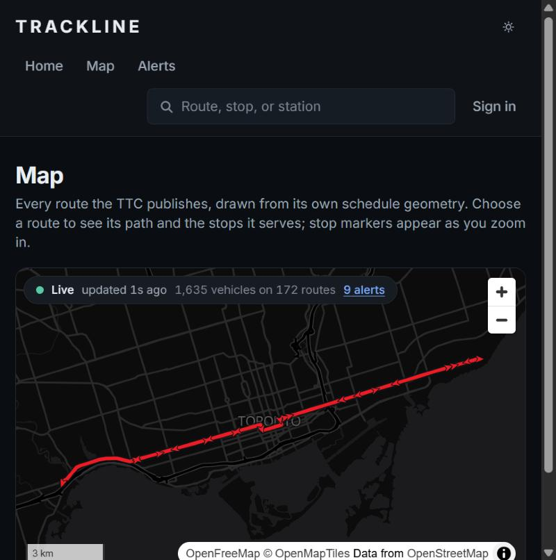

# Trackline

**See Toronto move.**

Trackline is a real-time transit intelligence platform for Toronto. It reads the TTC's public GTFS and GTFS-Realtime feeds and
turns them into things the feeds do not say on their own: where every bus and streetcar is along its route, whether a route's
vehicles are evenly spaced or running in a pack with a gap behind them, and how steady a route has been over days and weeks.



*A real capture, from this repository's containers running against the live TTC feeds, 2026-10-19, at a narrow window width.*

- **Live map.** Every vehicle the TTC publishes (about 1,600 on a weekday afternoon), streamed to the browser, eased between real
  reports and never drawn ahead of the latest one. A chip says how old the data is, and says so plainly when the feed goes quiet
  or the connection drops.
- **Route health.** Each route is judged on how evenly its vehicles are spaced, with a stated confidence, reason codes and the
  figures behind the verdict. It measures spacing, not lateness, because the TTC publishes no delay.
- **Bunching.** Vehicles running together are reported only when a service gap has opened elsewhere on the route, because a dense
  but evenly spaced route makes nobody wait longer.
- **Reliability over time.** Health is recorded every minute and summarised by the hour, so a route's reliability by hour and weekday
  can be shown. It declines to answer until enough has been recorded to say.
- **Service alerts,** with a lifecycle Trackline observes itself, because the feed publishes no start or end time.
- **Accounts,** only for saving routes and stops. Every page and read endpoint works without one.

Nothing here is estimated or mocked. Where the data does not support a claim, Trackline says so on screen instead of drawing one:
a subway line shows "Not published" (the TTC publishes no subway vehicle positions), a route with too few vehicles is `UNKNOWN`, and a
reliability chart is withheld until it has the observations behind it.

## How it fits together


An API (Spring Boot, Java 21) ingests the feeds, analyses them and serves them over REST and Server-Sent Events. A web application
(Next.js, TypeScript) renders them. PostgreSQL with PostGIS holds the schedule, route geometry, history and accounts; Redis holds the live
picture and can be lost without losing anything durable. [docs/architecture.md](docs/architecture.md) explains each part, one cycle of
ingestion end to end, what happens when each part fails, and where the design is thinner than it looks.

| Area | Choice |
| --- | --- |
| Backend | Java 21, Spring Boot 3.5, Maven; Flyway migrations, Hibernate set to validate only |
| Persistence | PostgreSQL 16 with PostGIS and `pg_trgm`: source of truth and history |
| Live state | Redis 7: ephemeral, rewritten each cycle, with a three-tier fallback when it is down |
| Realtime transport | Server-Sent Events |
| Frontend | Next.js 16 (App Router), React 19, TypeScript (strict), Tailwind CSS 4 |
| Mapping | MapLibre GL JS with OpenFreeMap tiles |
| Testing | JUnit 5, Testcontainers, WireMock, Vitest, Playwright |
| Delivery | Docker (multi-stage, non-root images), GitHub Actions; ECS Fargate and Vercel as the deployment target (not carried out) |

## What the data forced

The feeds were inspected directly before any design was fixed, and what they contain, and lack, shaped the architecture. The full
account is in [docs/data-sources.md](docs/data-sources.md); the consequences are these.

- **Realtime and static data cannot be joined on `trip_id`.** On the real feeds almost no vehicle's `trip_id` exists in the static
  schedule, and a `stop_id` matches little more than half the time. `route_id` matches every time, so the model is keyed on route and
  geometry, and a vehicle is placed by projecting its position onto its route's shape (PostGIS `ST_LineLocatePoint`) instead of by walking
  a trip.
- **There is no direction in the realtime feed,** so it is inferred from the vehicle's heading against the shape's, falling back to how far
  it has moved since it was last stored, and a vehicle that cannot be settled is `UNKNOWN` and left out of the analysis rather than guessed.
- **There is no delay in the feed,** so route health cannot say "late". It is built on how evenly vehicles are spaced.
- **There are no stations in the schedule,** so they are derived by clustering platform stops, and labelled as derived.
- **Alerts carry no active period or severity,** so Trackline records when it first and last saw each alert.

## The two algorithms

Both are plain, deterministic functions over a snapshot of vehicles with no framework and no clock, which is why they can be tested
exhaustively. Both run on every vehicle cycle, from the same placements.

**Route health** ([docs/route-health.md](docs/route-health.md)). For each direction of a route, the gaps between consecutive vehicles along
the route are compared with the timetable's spacing for the hour. The measures are the coefficient of variation of the gaps, the
largest gap against the expected one, and how many vehicles are running against how many the timetable has. The first rule that
matches gives one of `EXCELLENT`, `NORMAL`, `UNSTABLE`, `MAJOR_DISRUPTION` or `UNKNOWN`, with a confidence, reason codes and the inputs. There is no
0 to 100 score, because one would need weights the data cannot justify. The thresholds are a documented first judgement, not a calibration,
and the document records what the first run against the live feed got wrong and how it was corrected.

**Bunching** ([docs/bunching-detection.md](docs/bunching-detection.md)). Vehicles in one direction are sorted by distance along the route. A
pack is two or more vehicles each close behind the last, and it is reported only if some other gap on that direction is far larger than
expected. Both halves are required, because a dense but evenly spaced route is not a problem. A bunch is recorded as one event for its
whole life (opened when first seen, updated while it lasts, resolved after it has been gone for two analyses in a row), with times that are
when Trackline saw it and not when it formed.

## Run it

You need Docker. Everything below runs from the repository root.

```bash
cp .env.example .env
```

Edit `.env`: set `POSTGRES_PASSWORD`, and set `TRACKLINE_AUTH_JWT_SECRET` to a long random value (`openssl rand -base64 48`). The API
refuses to start without it, because a signing key anyone can read would make every token forgeable.

```bash
docker compose --profile full up -d --build
```

That builds the API and web images and starts PostgreSQL, Redis, the API (under the production profile) and the web application. Then load
the schedule once. The two settings stop this one-off process from polling the feeds beside the running API:

```bash
docker compose --profile full run --rm \
  -e TRACKLINE_GTFS_REALTIME_ENABLED=false -e TRACKLINE_HISTORY_ENABLED=false \
  api --import-gtfs
```

Open <http://localhost:3000>. The API is on <http://localhost:8080> (`/api-docs/ui` for its OpenAPI documentation). To check a running
stack, `node scripts/smoke.mjs --api http://localhost:8080 --web http://localhost:3000` runs the same fifteen checks a deployment would.

To stop it, `docker compose --profile full down` (add `-v` to discard the database).

## Develop it

For fast reloads, run only the stores in containers and the two applications natively.

```bash
docker compose up -d                    # PostgreSQL and Redis only
```

PostgreSQL and Redis are published on **56432** and **56379**, not their usual ports, so that a PostgreSQL or Redis installed natively
(including inside a WSL distribution, which Windows relays to `localhost`) cannot shadow the container's. That failure is quiet and
confusing, because connections succeed against the wrong server. Both ports come from `.env` and feed the published port and the API's
connection together.

**API** (Java 21):

```bash
cd services/api && set -a && . ../../.env && set +a && ./mvnw spring-boot:run
```

In PowerShell, load `.env` first:

```powershell
Get-Content ..\..\.env | Where-Object { $_ -match '=' -and $_ -notmatch '^#' } | ForEach-Object { $p = $_.Split('=',2); [Environment]::SetEnvironmentVariable($p[0].Trim(), $p[1].Trim()) }; .\mvnw spring-boot:run
```

It listens on 8080 with the `local` profile and migrates the schema at start. Load the schedule with `--import-gtfs` as an argument
(`./mvnw spring-boot:run -Dspring-boot.run.arguments=--import-gtfs`), or, while it runs under the `local` profile, `curl -X POST
http://localhost:8080/api/v1/admin/gtfs/import`. That endpoint exists only where `trackline.gtfs.static.admin-endpoint` is true and is
off in the production profile, because nothing could protect it.

**Web:**

```bash
cd apps/web && corepack pnpm install && corepack pnpm dev
```

It serves on 3000 and reads the API at `NEXT_PUBLIC_API_BASE_URL` (default `http://localhost:8080`). pnpm comes with Node through
Corepack, so nothing is installed globally. `pnpm dev` and `pnpm build` first copy MapLibre's web worker into `public/vendor/`, because MapLibre
finds it through `import.meta.url`, which a bundler rewrites to a path where it does not exist, and the map then renders nothing and logs only
"Worker failed to load"; the copy is made from the installed version and is not committed.

### The API in brief

Every list endpoint caps its page size, radius and result count, and a request over a cap is a `400` naming the offending parameter.
Errors are RFC 7807 problem details with no stack trace. Responses carrying feed-derived data are wrapped in an envelope that states their
age and origin:

```json
{
  "data": { "vehiclesTracked": 1574, "routesReporting": 168, "activeAlerts": 12 },
  "meta": {
    "generatedAt": "2026-10-19T17:33:22Z",
    "feedTimestamp": "2026-10-19T17:32:45Z",
    "ageSeconds": 37,
    "stale": false,
    "degraded": false,
    "source": "LIVE"
  }
}
```

`source` is `LIVE` (the shared Redis cache), `CACHED` (this instance's own copy, because Redis was unreachable), `DB_FALLBACK`
(rebuilt from stored positions, the stalest), `STORED` or `STATIC` (read from the database), or `NO_DATA` (nothing ingested yet, which is not
the same as no vehicles running). `CACHED` and `DB_FALLBACK` also set `degraded`. Unknown values are `null`, never zero-filled.

| Endpoint | Purpose |
| --- | --- |
| `GET /api/v1/network/status` | Vehicles tracked, routes reporting, alerts, and the age of the feed |
| `GET /api/v1/routes`, `/routes/{id}`, `/routes/{id}/shape`, `/routes/{id}/stops` | The schedule: routes, geometry (GeoJSON, optionally simplified), stops in order |
| `GET /api/v1/stops/{id}`, `/stops/nearby` | A stop and the routes that call there; stops near a point, nearest first |
| `GET /api/v1/search` | Routes, stops and stations by name or number |
| `GET /api/v1/vehicles`, `/routes/{id}/vehicles` | Live vehicles, by route or bounding box |
| `GET /api/v1/routes/{id}/health`, `/health/routes` | Route health verdicts with their reasons and figures |
| `GET /api/v1/routes/{id}/bunching` | The spacing of a route's vehicles and any bunching, now and recently |
| `GET /api/v1/routes/{id}/reliability` | Reliability over a window, or `INSUFFICIENT_HISTORY` saying how much there is and how much is needed |
| `GET /api/v1/alerts`, `/alerts/{id}` | Service alerts, active or ended |
| `GET /api/v1/stream/vehicles`, `/stream/network` | Server-Sent Events: a snapshot, then only what changed |
| `POST /api/v1/auth/register`, `/login`, `/refresh`, `/logout`; `GET /auth/me` | Accounts |
| `GET`, `PUT`, `DELETE /api/v1/favourites/...` | Saved routes and stops, for the signed-in person only |
| `GET /actuator/health` | Liveness and readiness (the only actuator endpoint in production) |

The documents for each area: [streaming](docs/streaming.md), [route progress](docs/route-progress.md), [alerts](docs/alerts.md),
[history and reliability](docs/history-and-reliability.md), [authentication](docs/authentication.md).

## Test it

| Suite | Command | Count | What it covers |
| --- | --- | ---: | --- |
| API | `cd services/api && ./mvnw verify` | 925 tests in 81 classes | Pure algorithm tests against real captured feeds; PostgreSQL/PostGIS and Redis in Testcontainers (migrations from scratch, spatial queries, the Redis-down path, the production profile); WireMock pipeline tests for malformed, empty, stale and failing feeds; the stream; authentication and cross-user denial |
| Web, unit | `cd apps/web && corepack pnpm test` | 716 tests in 49 files | Components and every loading, empty, error, stale and degraded state; the live-store reducer; interpolation never extrapolating |
| Web, end to end | `cd apps/web && corepack pnpm e2e` | 29 tests, desktop and phone | Real Chrome against the real stack |
| Live contract | `cd services/api && ./mvnw test -Dgroups=live -DexcludedGroups=` | run by the nightly workflow | That the real TTC feeds still parse and still carry, and still lack, the fields the design rests on |

Counts as of 2026-10-19, from the last full run (the API build took about three minutes on the laptop above, with the compiler's warnings as errors). The end-to-end suite runs the **packaged API jar**, a real PostgreSQL and Redis, and the real importer, in a
dedicated database; the only thing replaced is the TTC, by a small server that speaks the same protobuf (`apps/web/e2e/fixture-feed`). It exercises
ingestion, placement, health, bunching, the stream and sign-in for real, and nothing it asserts depends on the TTC being up or on the time of day. Build
the jar first (`cd services/api && ./mvnw -DskipTests package`); the stack starts itself, and `node e2e/stack.ts up` starts it by hand for a look.

The fixtures behind the deterministic tests are real captures of the TTC's feeds, trimmed. The tests that reach the real feeds are tagged
`live`, excluded from the normal build on purpose, and run nightly.

**Continuous integration** (`.github/workflows`) runs the API build with the compiler's warnings as errors, the web lint, types, unit tests,
build and a dependency audit, the end-to-end suite, both image builds and a start of the whole stack, and CodeQL for both languages. The nightly
workflow runs the live contract tests and a from-scratch rehearsal that imports the real schedule and runs the smoke test. These were checked
statically (actionlint) and every command in them was run locally, but **they have not been run by GitHub**, which could not be done from the
machine they were written on.

## Measured

Every figure below is dated, comes from a run described in [docs/performance.md](docs/performance.md), and is for one laptop (13th-gen Intel Core i7-1355U,
10 cores, 15.7 GB, Windows 11, Docker Desktop 29.2.0), not a server.

| What | Measurement | Date |
| --- | --- | --- |
| Static schedule import, empty database, in the production container | **129.7 s** for 4,943,365 rows: 236 routes, 9,409 stops, 138,036 trips, 438,263 shape points, 4,357,307 stop times; then 1,571 route shapes, 108 stations and 20,945 scheduled headways derived. Re-importing an unchanged archive: 2.5 s | 2026-10-19 |
| One vehicle cycle (fetch, validate, place, store, analyse, publish), about 1,590 vehicles | median 508 ms, p95 620 ms (11 successful cycles, quiet machine). The feed itself publishes about every 20 s | 2026-10-19 |
| Read endpoints, one client at a time (200 requests each, 14 endpoints) | median 8 to 19 ms and p95 13 to 32 ms, except search at 35 / 44 ms; the 346 KB whole-fleet snapshot 15.7 / 32.4 ms | 2026-10-19 |
| Redis hit ratio over that benchmark (1,320 live-state reads) | 1,320 hits, 0 misses | 2026-10-19 |
| Live stream, 25 clients, 1,500-vehicle fleet, 30 cycles | 750 of 750 deliveries; publish to receipt median 10.5 to 11.1 ms, p95 20.9 to 24.2 ms | 2026-10-19 |
| Production images | API 610 MB, web 393 MB on disk | 2026-10-19 |
| The API in a container limited to 0.5 vCPU and 1 GiB | works; peak memory 413 MB of 1 GiB; medians barely move and tails grow (see performance.md) | 2026-10-19 |

## Deploying it

The target is the API on AWS ECS Fargate with RDS and Redis, and the web application on Vercel. **This has not been done.** It needs cloud
accounts and credentials that are the owner's to use, so [docs/deployment.md](docs/deployment.md) is a runbook for doing it, with a smoke test
(`scripts/smoke.mjs`) to prove it worked, and a plain list of what was verified on a laptop and what could only be read from documentation.

## What is not built

Deliberate omissions, so nobody has to find them:

- **Arrivals, stop pages and route pages.** There is no `/stops/{id}/arrivals` endpoint and no per-stop or per-route page: a route's detail is
  the panel on the map, and a stop is selected from its route. The realtime feeds' stop matching (little more than half) would limit arrivals.
- **A search box that searches.** `GET /api/v1/search` exists and is tested; the header's field is not wired to it yet. The map filters its own list.
- **Horizontal scaling.** Exactly one API instance may run, because the single-flight guard is in-process and the planned PostgreSQL advisory lock
  was not built. See [docs/architecture.md](docs/architecture.md).
- **A circuit breaker on Redis.** The API degrades correctly when Redis is down, but every request waits out Redis's 500 ms timeout first.
- **Rate limiting.** Beyond the stream's connection caps (500 in total, 20 per address) the public API has no per-client limit. Put one in front.
- **Delay and on-time performance,** which the TTC does not publish.
- **Subway vehicles,** which the TTC does not publish.

Follow-ups worth doing next: a commute watch that tells a person when their saved route turns unstable; arrivals at stops where the stop ids
match; the advisory lock and a Redis circuit breaker; calibrating the health thresholds against the distribution the history now collects.

## Layout

```
apps/web/            the Next.js application, its tests, and e2e/ (Playwright and the fixture feed)
services/api/        the Spring Boot application, its migrations and tests
docs/                architecture, data sources, each algorithm, performance, deployment
scripts/             smoke.mjs (post-deploy check), bench.mjs (endpoint latency), streams-per-address-check.mjs
.github/             workflows and Dependabot configuration
docker-compose.yml   the stores, and with --profile full the API and web
```

## Licence

TTC data is published under the Open Government Licence – Toronto. Basemap tiles are from OpenFreeMap, with data from OpenStreetMap
contributors and tiles by OpenMapTiles.
